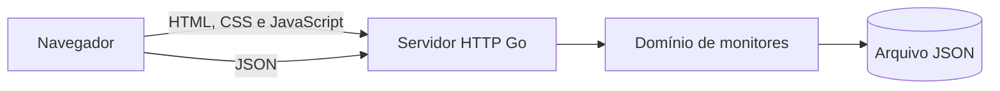

# GoPing


[](https://go.dev/)
[](https://github.com/hendelsantos/Goping/actions/workflows/ci.yml)
[](go.mod)
[](#roadmap)

**Dashboard e API REST em Go para monitoramento de sites e APIs.**

[Visão geral](#sobre-o-projeto) · [Executar](#executando-localmente) · [API](#api-http) · [Arquitetura](#arquitetura) · [Roadmap](#roadmap)

## Sobre o projeto

O **GoPing** é uma plataforma open source de monitoramento de disponibilidade e latência. O projeto nasceu como um estudo prático de engenharia backend com Go e evolui em etapas, mantendo a arquitetura pequena, testável e fácil de explicar.

Atualmente, o GoPing oferece um dashboard responsivo integrado a uma API Go. O cadastro de monitores e o histórico de atividades são persistidos no servidor em JSON. A execução periódica das verificações HTTP pertence ao próximo marco e ainda não deve ser considerada concluída.

## Funcionalidades

### Disponíveis

- Dashboard responsivo para desktop e dispositivos móveis.
- API REST construída apenas com a biblioteca padrão do Go.
- Cadastro, listagem e exclusão de monitores.
- Busca e filtro por estado no frontend.
- Persistência JSON com gravação atômica e acesso concorrente protegido.
- Registro de atividades da aplicação.
- Validação de entrada e erros JSON padronizados.
- Logs estruturados e encerramento gracioso do servidor.
- Cabeçalhos HTTP de segurança e limite para corpos de requisição.
- Testes de unidade e integração com `httptest` e detector de corrida.
- HTML semântico, metadados Open Graph, JSON-LD, sitemap e acessibilidade básica.

### Em desenvolvimento

- Verificações HTTP/HTTPS reais com timeout e medição de latência.
- Histórico de resultados e cálculo real de uptime.
- Scheduler e worker pool com concorrência controlada.
- Persistência SQLite e migrations.
- Proteção completa contra SSRF antes de aceitar cadastros públicos.
- Alertas, autenticação, página pública de status e deploy.

## Tecnologias

| Camada | Tecnologia |
| --- | --- |
| Backend | Go, `net/http`, `encoding/json`, `log/slog` |
| Frontend | HTML semântico, CSS e JavaScript sem framework |
| Persistência atual | Arquivo JSON com escrita atômica |
| Testes | `testing`, `httptest` e race detector |
| Qualidade | `gofmt`, `go vet` e GitHub Actions |

## Executando localmente

### Pré-requisitos

- Go `1.27.1` ou versão compatível.
- Git para clonar o repositório.

### Instalação

```bash
git clone https://github.com/hendelsantos/Goping.git
cd Goping
go run ./cmd/goping-server
```

Acesse [http://localhost:8080](http://localhost:8080).

O primeiro início apresenta dados sintéticos para demonstrar o dashboard. Alterações posteriores são salvas em `data/goping.json`, arquivo ignorado pelo Git.

### Configuração

```bash
go run ./cmd/goping-server \
  -addr :9090 \
  -data data/goping.json \
  -web .
```

| Opção | Padrão | Descrição |
| --- | --- | --- |
| `-addr` | `:8080` | Endereço e porta do servidor HTTP |
| `-data` | `data/goping.json` | Arquivo de persistência |
| `-web` | `.` | Diretório dos arquivos públicos |
| `PORT` | vazio | Porta fornecida por plataformas de hospedagem |

## API HTTP

| Método | Endpoint | Descrição | Sucesso |
| --- | --- | --- | --- |
| `GET` | `/healthz` | Verifica a saúde do processo | `200` |
| `GET` | `/api/v1/monitors` | Lista monitores | `200` |
| `POST` | `/api/v1/monitors` | Cria um monitor | `201` |
| `DELETE` | `/api/v1/monitors/{id}` | Exclui um monitor | `204` |
| `GET` | `/api/v1/activities` | Lista atividades | `200` |
| `DELETE` | `/api/v1/activities` | Limpa atividades | `204` |

Exemplo de cadastro:

```bash
curl -X POST http://localhost:8080/api/v1/monitors \
  -H 'Content-Type: application/json' \
  -d '{
    "name": "Meu site",
    "url": "https://example.com",
    "interval_seconds": 300,
    "timeout_seconds": 10
  }'
```

Os contratos, validações e respostas estão documentados em [docs/api.md](docs/api.md).

## Arquitetura

O projeto usa um monólito modular. Um único processo serve o frontend e a API:



```text
.
├── cmd/goping-server/          # Inicialização e ciclo de vida
├── internal/
│   ├── monitor/                # Modelos, validação e persistência
│   └── web/                    # API, middlewares e arquivos públicos
├── docs/
│   ├── decisions/              # Registros de decisões arquiteturais
│   ├── api.md                  # Contratos HTTP
│   └── architecture.md         # Arquitetura atual e planejada
├── assets/                     # Identidade visual
├── app.js                      # Integração do dashboard com a API
├── index.html                  # Interface e metadados SEO
└── styles.css                  # Sistema visual responsivo
```

Mais detalhes em [docs/architecture.md](docs/architecture.md) e no [plano do projeto](GoPing_PLANO_PROJETO.md).

## Testes e qualidade

```bash
# Testes de todos os pacotes
go test ./...

# Testes com detector de condições de corrida
go test -race ./...

# Cobertura e análise estática
go test -cover ./...
go vet ./...
```

A integração contínua executa testes, race detector e `go vet` em pushes e pull requests para `main`.

## Segurança

URLs controladas por usuários criam risco de **SSRF**. O GoPing ainda não executa as URLs cadastradas. Antes da implementação do checker público, serão obrigatórios bloqueio de redes privadas e metadados de nuvem, validação de DNS e redirecionamentos, limites de porta, autenticação e rate limiting.

Até essas proteções estarem implementadas e testadas, use o projeto localmente e cadastre apenas URLs confiáveis.

## Roadmap

- [x] Dashboard responsivo e identidade visual.
- [x] API REST para monitores e atividades.
- [x] Persistência JSON e testes automatizados.
- [ ] Checker HTTP seguro com timeout e latência.
- [ ] Histórico de verificações e SQLite.
- [ ] Scheduler e worker pool.
- [ ] Alertas por e-mail, Telegram e webhook.
- [ ] Autenticação e página pública de status.
- [ ] Docker, observabilidade e deploy público.

## Decisões do projeto

- [ADR 001 — frontend sem framework](docs/decisions/001-vanilla-frontend.md)
- [ADR 002 — persistência JSON antes do SQLite](docs/decisions/002-json-persistence.md)

## Autor

Desenvolvido por [Hendel Santos](https://github.com/hendelsantos) como projeto de portfólio e aprendizado aprofundado em Go.

## Licença

A licença open source será definida antes da primeira versão estável. Até lá, consulte o autor antes de reutilizar ou redistribuir o código.
