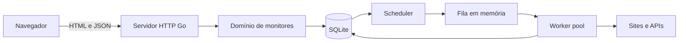

# Arquitetura do GoPing

## Contexto

O GoPing monitora endpoints HTTP/HTTPS, registra resultados e apresenta disponibilidade, latência e incidentes. O público inicial são desenvolvedores independentes, pequenos sites e mantenedores de APIs.

## Estado atual

A aplicação é um monólito Go executável:

- `cmd/goping-server` configura o servidor e seu encerramento gracioso.
- `internal/web` expõe a API, arquivos públicos e cabeçalhos de segurança.
- `internal/monitor` valida e persiste monitores e atividades.
- `app.js` consome a API e mantém apenas estado visual no navegador.
- O arquivo `data/goping.json` é escrito de forma atômica e protegido por mutex.

Os dados iniciais são sintéticos e nenhuma URL é consultada. Esse limite evita apresentar o scheduler e o checker como concluídos antes das proteções SSRF.

## Arquitetura alvo do MVP

No estado atual, a fonte durável é um arquivo JSON. No MVP de monitoramento, o servidor, scheduler e workers serão executados em um único processo e SQLite substituirá o arquivo sem alterar o contrato HTTP.

## Responsabilidades

| Componente | Responsabilidade | Não deve fazer |
| --- | --- | --- |
| HTTP | Validar entrada, serializar respostas e servir a interface | Implementar regras de saúde |
| Domínio | Definir monitor, resultado e regra `UP/DOWN/UNKNOWN` | Conhecer detalhes de SQL ou HTML |
| Storage | Persistir e consultar monitores e resultados | Executar requisições externas |
| Scheduler | Selecionar verificações vencidas e evitar duplicidade | Decidir o resultado HTTP |
| Checker | Fazer requisições seguras com timeout e medir latência | Agendar a próxima execução |
| Worker pool | Limitar concorrência e encerrar com `context` | Persistir fora das interfaces definidas |

## Fluxo de uma verificação

1. O scheduler consulta monitores habilitados cuja execução está vencida.
2. Cada monitor entra uma vez na fila interna.
3. Um worker valida o destino e executa a requisição com timeout.
4. O checker classifica HTTP `200–399` como `UP` na regra inicial.
5. O resultado e a próxima execução são persistidos na mesma unidade lógica.
6. O dashboard consulta o estado atual, o histórico e os resumos pela API.

## Segurança obrigatória

O checker será uma fronteira de segurança. Antes de aceitar URLs públicas, deve:

- permitir apenas `http` e `https` e portas aprovadas;
- rejeitar credenciais embutidas e URLs excessivamente longas;
- bloquear loopback, redes privadas, link-local, multicast e metadados de nuvem;
- validar os IPs resolvidos também no momento da conexão;
- revalidar cada redirecionamento e limitar sua quantidade;
- limitar timeout, concorrência, cabeçalhos e tamanho de resposta;
- remover dados sensíveis de logs e mensagens de erro.

## Integração do frontend

O HTML permanece sem framework e o JavaScript consome estes contratos já implementados:

1. `GET /api/v1/monitors` alimenta a listagem.
2. `POST /api/v1/monitors` substitui o cadastro local.
3. `DELETE /api/v1/monitors/{id}` substitui a exclusão local.
4. `GET` e `DELETE /api/v1/activities` alimentam e limpam a atividade.

Os endpoints de resumo e histórico serão adicionados quando existirem verificações reais.

## Critérios para evoluir a arquitetura

- Migrar SQLite para PostgreSQL somente ao operar múltiplas instâncias ou atingir limitações medidas.
- Separar frontend e backend somente se ciclos de deploy, equipe ou complexidade justificarem.
- Introduzir fila externa apenas quando recuperação, volume e distribuição não forem atendidos pelo banco e pela fila interna.
- Adicionar abstrações depois que houver pelo menos duas implementações reais ou complexidade comprovada.
